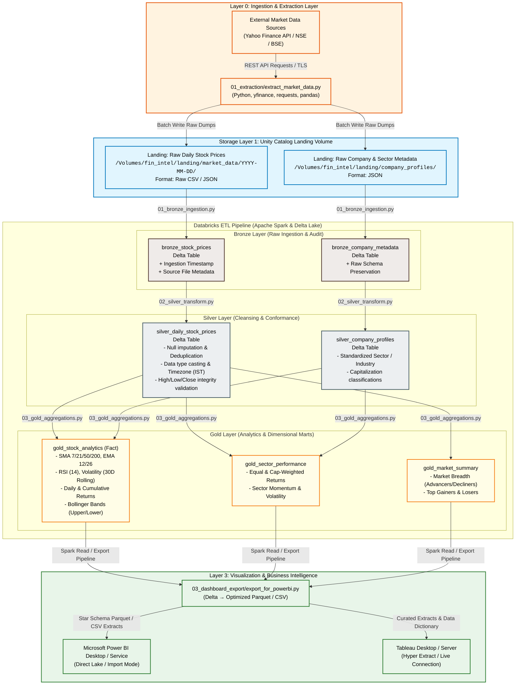

# Financial Market Intelligence — End-to-End Architecture Diagram

## 1. Architectural Overview

The **Financial Market Intelligence** data engineering platform is designed following the industry-standard **Medallion Architecture (Bronze → Silver → Gold)** implemented on **Databricks**, **Delta Lake**, and **Apache Spark**, with unified governance via **Databricks Unity Catalog**.

Data is ingested from Indian Equity Markets (National Stock Exchange - NSE) via financial data APIs, staged into Unity Catalog Volumes, incrementally processed and cleaned through Delta Lake tables, and served as analytics-ready star schema dimensional models for downstream consumption in Power BI and Tableau.

---

## 2. Mermaid.js System Architecture Diagram

---

## 3. Layer-by-Layer Architectural Specifications

### Layer 0: Ingestion & Extraction Layer
- **Source:** Yahoo Finance API (`yfinance`), NSE historical price feeds.
- **Coverage:** Blue-chip and high-impact Indian equities across core sectors:
  - Financials: `HDFCBANK.NS`, `ICICIBANK.NS`, `SBIN.NS`
  - Information Technology: `TCS.NS`, `INFY.NS`, `WIPRO.NS`
  - Energy & Utilities: `RELIANCE.NS`, `NTPC.NS`, `ONGC.NS`
  - Consumer / Auto: `HINDUNILVR.NS`, `TATAMOTORS.NS`
- **Output:** Raw CSV OHLCV timeseries files and company metadata JSON documents.

### Storage Layer 1: Databricks Unity Catalog Volume (Landing Zone)
- **Path Pattern:** `/Volumes/<catalog>/<schema>/landing/market_data/`
- **Characteristics:** Immutable, append-only raw file landing zone. Preserves untouched raw payloads for auditability, lineage tracking, and zero-loss reprocessing.

### ETL Layer 2: Apache Spark & Delta Lake (Databricks)
1. **Bronze Layer:**
   - Append-only raw Delta tables with complete audit metadata (`_ingestion_timestamp`, `_source_file`).
   - ACID transaction guarantees, schema validation on write.
2. **Silver Layer:**
   - Deduplicated on `(symbol, trade_date)`.
   - Data cleaning: NULL handling, invalid price elimination (e.g. Low $\le$ High, Volume $\ge$ 0).
   - Datetime casting: Standardized IST/UTC dates.
   - Enriched with standard company profile attributes (Sector, Industry, Market Cap Category).
3. **Gold Layer:**
   - Star schema design tailored for high-performance financial analytics.
   - Windowing analytics:
     - Simple Moving Averages (7, 21, 50, 200 sessions).
     - Exponential Moving Averages (12, 26 sessions).
     - Relative Strength Index (RSI - 14 session Wilders/Standard approximation).
     - 30-day Rolling Volatility (annualized with $\sqrt{252}$).
     - Daily percentage price change and log returns.
     - Sector performance benchmarks (equal-weight and capitalization-weighted return indices).

### Visualization Layer 3: Serving & Business Intelligence
- **Consumers:** Power BI Desktop / Service, Tableau Desktop / Cloud.
- **Data Model:** Star Schema:
  - Fact: `Fact_StockAnalytics`
  - Dimensions: `Dim_Date`, `Dim_Company`, `Dim_Sector`
- **Export Formats:** Columnar Apache Parquet (snappy compression) & UTF-8 clean CSV with formatted headers.
