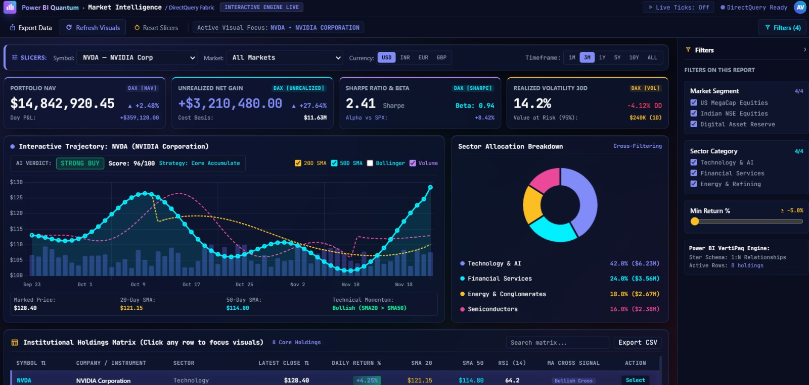

# ⚡ QUANTUM HORIZON
### Financial Market Intelligence & Big Data Analytics

<p align="center">
  <strong>From market data engineering to interactive financial intelligence</strong>
</p>

<p align="center">
  <a href="https://github.com/invictussss/Quantum-Horizon"></a>
  
  
  
  
</p>

---

## 📌 Project Overview

**Quantum Horizon** is a financial market intelligence and Big Data analytics project. It brings together market-data extraction, distributed processing, structured analytics, quantitative indicators, and business-intelligence dashboards.

The data-engineering workflow is organized around a **Bronze → Silver → Gold Medallion Architecture** using Python, Apache Spark / PySpark, Databricks, and Delta Lake. Curated outputs are prepared for analytical reporting and dashboard consumption.

The repository also contains quantitative analysis scripts, a market-trend notebook, dashboard assets, and Power BI-related work.

## 📊 Dashboard Preview

The following screenshot shows the interactive Power BI market-intelligence dashboard.



### Dashboard highlights

- Portfolio Net Asset Value (NAV) and daily P&L
- Unrealized gain and cost basis
- Sharpe ratio, beta, and realized volatility
- Interactive price trajectory with moving averages and Bollinger Bands
- Sector allocation breakdown
- Institutional holdings matrix
- Market, symbol, currency, and timeframe filters

## 🏗️ Data Engineering Architecture

The documented pipeline follows this flow:

```text
Market Data Extraction
        |
        v
Raw Landing / Ingestion
        |
        v
BRONZE - Raw Delta Tables
        |
        v
SILVER - Cleaned & Validated Data
        |
        v
GOLD - Curated Analytics & Star Schema
        |
        v
Power BI / Tableau Reporting
```

### Medallion layers

| Layer | Purpose |
|---|---|
| **Bronze** | Ingest and preserve source data with ingestion metadata. |
| **Silver** | Clean, validate, standardize, and deduplicate records. |
| **Gold** | Calculate analytical metrics and prepare curated reporting tables. |

For the detailed pipeline design, data dictionary, architecture diagram, and execution guide, see the [Financial Market Intelligence documentation](BDA%20Project/financial-market-intelligence/README.md).

## 📈 Analytics & Quantitative Features

The project documentation and scripts cover financial analysis such as:

- Moving averages and trend signals
- RSI and Bollinger Bands
- Daily and logarithmic returns
- Rolling realized volatility
- Sector performance and market breadth
- Investment recommendation logic
- Long-horizon market-data analysis

The dashboard screenshot is an illustrative view of the interactive reporting layer; calculated values depend on the selected data and filters.

## 🛠️ Technology Stack

| Area | Tools |
|---|---|
| Data extraction | Python, yfinance, pandas, requests |
| Distributed processing | Apache Spark, PySpark, Spark SQL |
| Lakehouse storage | Delta Lake |
| Data platform & governance | Databricks, Unity Catalog |
| Analytics | NumPy, pandas, SciPy, scikit-learn |
| Business intelligence | Microsoft Power BI, Tableau |
| Visualization / app layer | Streamlit, Plotly, Chart.js |
| Data modeling | Star Schema, DAX, Power Query |

## 🗂️ Repository Structure

```text
Quantum-Horizon/
├── README.md
├── assets/
│   └── powerbi-dashboard.jpeg
└── BDA Project/
    ├── financial-market-intelligence/
    │   ├── README.md
    │   ├── architecture-diagram.md
    │   ├── 01_extraction/
    │   ├── 02_databricks_notebooks/
    │   ├── 03_dashboard_export/
    │   ├── 04_dashboard/
    │   ├── 05_powerbi_dashboard/
    │   ├── add_investment_recommendation_engine.py
    │   ├── generate_10y_global_data.py
    │   ├── live_market_trend_analysis.ipynb
    │   ├── upgrade_10y_global_intelligence.py
    │   └── upgrade_pbi_10y.py
    └── (additional project scripts)
```

## 🚀 Getting Started

1. Open the [Financial Market Intelligence project folder](BDA%20Project/financial-market-intelligence/).
2. Read its [detailed README and execution guide](BDA%20Project/financial-market-intelligence/README.md).
3. Review the [architecture diagram](BDA%20Project/financial-market-intelligence/architecture-diagram.md).
4. Follow the extraction, Databricks notebook, and dashboard-export steps documented there.

> **Note:** The detailed README contains the pipeline-specific prerequisites, commands, storage paths, and Databricks execution instructions. Follow that guide for the current implementation rather than assuming the project can be run from the repository root.

## 👥 Project Team

| Name | Role | Responsibilities |
|---|---|---|
| Sanyam Sharma | Project Lead & UI/UX Engineer | Streamlit, Plotly, Chart.js |
| Ankush Sangwan | Lead Data Architect | PySpark, Databricks, Delta Lake |
| Vikash Kumar | Quantitative Modeling & AI Lead | Python, NumPy, SciPy, Scikit-Learn |
| Yash Kumar Gautam | Power BI & Dimensional Modeling Architect | Power BI, DAX, Power Query |

## ⚠️ Disclaimer

This project is intended for educational and analytical purposes. Quantitative indicators and model-generated recommendations are informational outputs, not personalized investment advice.

---

<p align="center">
  <strong>QUANTUM HORIZON</strong><br>
  Big Data • Financial Intelligence • Quantitative Analytics
</p>
